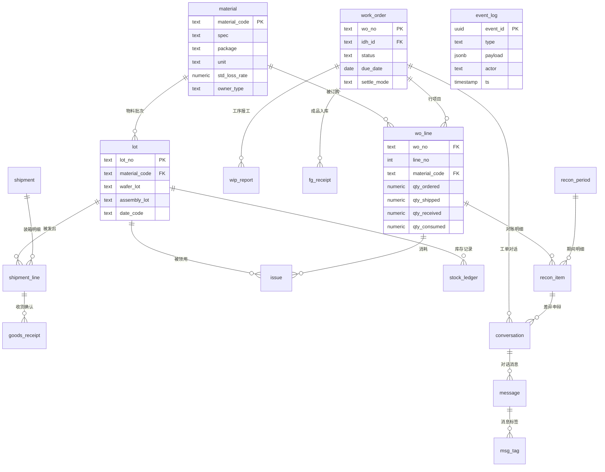

# IDH 协同平台 · 数据库设计文档

> 版本: V1.0 | 日期: 2026-11 | 数据库: PostgreSQL 15

---

## 1. 设计原则

### 1.1 五条唯一性约束（来自方案 05 章）

| # | 约束 | 规则 | 理由 |
|---|------|------|------|
| 1 | `material_code` 全局唯一 | 原厂物料码为主键，IDH 自有料号作别名映射 | 同一芯片在两个系统必须是同一个东西 |
| 2 | `lot_no` 全局唯一 | `晶圆批-封装批-DateCode` 组合，IDH 不得自编 | 批次是追溯与责任界定的唯一锚点 |
| 3 | `container_id` 唯一 | 箱/盘/袋三级容器码，父子固定，拆并不改历史 | 数量差异 90% 来自"盘→颗"换算 |
| 4 | `event_id` 唯一且只追加 | 每条业务事件不可修改，更正靠反向事件冲销 | 保证账可审计、可回溯到人 |
| 5 | `(wo_id, line_no)` 唯一 | 工单行项目粒度，支持分批交付 | 一张工单多批发货是常态 |

### 1.2 核心设计决策

| 决策 | 说明 |
|------|------|
| **主库选 PostgreSQL 15** | RLS 做租户隔离；JSONB 存事件 payload；递归 CTE 做批次追溯 |
| **数量四字段分拆** | `qty_ordered / qty_shipped / qty_received / qty_consumed`，不合并为单一"已完成数量" |
| **事件溯源** | 所有账由 `event_log` 累加算出，禁止直接 UPDATE 账本表 |
| **行级安全（RLS）** | 租户隔离在数据库层而非应用层，防止应用漏写 `WHERE idh_id=?` |
| **金额与数量分离** | 数量账与金额账独立建模，发票只参与金额结算不参与数量勾稽 |

---

## 2. ER 图（核心实体关系）



---

## 3. 完整表结构

### 3.1 主数据域

#### `material` — 物料主数据

| 字段 | 类型 | 约束 | 说明 |
|------|------|------|------|
| `material_code` | `VARCHAR(64)` | **PK** | 原厂物料编码，全局唯一 |
| `spec` | `VARCHAR(256)` | NOT NULL | 规格描述 |
| `package` | `VARCHAR(32)` | NOT NULL | 封装类型（BGA/QFN/WLCSP…） |
| `unit` | `VARCHAR(8)` | NOT NULL DEFAULT `'颗'` | 基准计量单位 |
| `std_loss_rate` | `NUMERIC(5,4)` | NOT NULL DEFAULT 0 | 标准损耗率（如 0.005 = 0.5%） |
| `owner_type` | `VARCHAR(16)` | NOT NULL CHECK(IN('purchase','consignment','sample')) | 归属类型：购销/寄售/样品 |
| `is_active` | `BOOLEAN` | NOT NULL DEFAULT TRUE | 启用标记 |
| `created_at` | `TIMESTAMPTZ` | NOT NULL DEFAULT NOW() | |
| `updated_at` | `TIMESTAMPTZ` | | |

**索引:**
```sql
CREATE UNIQUE INDEX uk_material_code ON material(material_code);
CREATE INDEX idx_material_owner ON material(owner_type) WHERE is_active;
```

#### `material_alias` — IDH 料号别名映射

| 字段 | 类型 | 约束 | 说明 |
|------|------|------|------|
| `id` | `BIGSERIAL` | **PK** | |
| `material_code` | `VARCHAR(64)` | **FK → material** | 原厂料号 |
| `idh_id` | `VARCHAR(32)` | NOT NULL | IDH 标识 |
| `alias_code` | `VARCHAR(64)` | NOT NULL | IDH 自用料号 |
| `created_at` | `TIMESTAMPTZ` | NOT NULL DEFAULT NOW() | |

**索引:**
```sql
CREATE UNIQUE INDEX uk_alias ON material_alias(idh_id, alias_code);
CREATE INDEX idx_alias_material ON material_alias(material_code);
```

#### `lot` — 批次台账

| 字段 | 类型 | 约束 | 说明 |
|------|------|------|------|
| `lot_no` | `VARCHAR(64)` | **PK** | 批次号，格式: `晶圆批-封装批-DateCode` |
| `material_code` | `VARCHAR(64)` | **FK → material**, NOT NULL | 料号 |
| `wafer_lot` | `VARCHAR(32)` | NOT NULL | 晶圆批次 |
| `assembly_lot` | `VARCHAR(32)` | NOT NULL | 封装批次 |
| `date_code` | `VARCHAR(8)` | NOT NULL | DateCode（YYWW） |
| `qty_in` | `NUMERIC(12,0)` | NOT NULL DEFAULT 0 | 总入库量（颗） |
| `qty_available` | `NUMERIC(12,0)` | NOT NULL DEFAULT 0 | 当前可用量 |
| `qty_allocated` | `NUMERIC(12,0)` | NOT NULL DEFAULT 0 | 已分配量 |
| `qty_frozen` | `NUMERIC(12,0)` | NOT NULL DEFAULT 0 | 冻结量 |
| `owner_idh` | `VARCHAR(32)` | | 物理所在 IDH（NULL = 原厂仓库） |
| `ownership` | `VARCHAR(16)` | NOT NULL DEFAULT 'factory' CHECK(IN('factory','idh')) | 产权归属 |
| `status` | `VARCHAR(16)` | NOT NULL DEFAULT 'active' CHECK(IN('active','frozen','expired')) | |
| `expiry_date` | `DATE` | | 有效期 |
| `created_at` | `TIMESTAMPTZ` | NOT NULL DEFAULT NOW() | |

**索引:**
```sql
CREATE UNIQUE INDEX uk_lot_no ON lot(lot_no);
CREATE INDEX idx_lot_material ON lot(material_code);
CREATE INDEX idx_lot_owner ON lot(owner_idh);
CREATE INDEX idx_lot_aging ON lot(created_at) WHERE status='active' AND qty_available>0;
```

---

### 3.2 工单域

#### `work_order` — 工单主表

| 字段 | 类型 | 约束 | 说明 |
|------|------|------|------|
| `wo_no` | `VARCHAR(32)` | **PK** | 工单号 |
| `idh_id` | `VARCHAR(32)` | NOT NULL | 承接方 IDH |
| `customer_id` | `VARCHAR(64)` | | 终端客户（可选） |
| `status` | `VARCHAR(16)` | NOT NULL DEFAULT 'draft' | 见状态枚举 |
| `due_date` | `DATE` | NOT NULL | 交付日期 |
| `bom_ver` | `VARCHAR(16)` | | 工艺/BOM 版本 |
| `settle_mode` | `VARCHAR(16)` | NOT NULL CHECK(IN('purchase','consignment','toll')) | 结算方式：购销/寄售/委外 |
| `priority` | `SMALLINT` | DEFAULT 5 | 优先级 1-10 |
| `version` | `INT` | NOT NULL DEFAULT 1 | 变更版本号 |
| `created_by` | `VARCHAR(64)` | NOT NULL | 创建人 |
| `created_at` | `TIMESTAMPTZ` | NOT NULL DEFAULT NOW() | |
| `updated_at` | `TIMESTAMPTZ` | | |

**状态枚举:**
```
draft → issued → accepted → material_ready → in_production
→ partial_complete → fully_complete → shipped → reconciled → closed
旁支: suspended / changed / cancelled
```

**索引:**
```sql
CREATE INDEX idx_wo_idh ON work_order(idh_id);
CREATE INDEX idx_wo_status ON work_order(status);
CREATE INDEX idx_wo_due ON work_order(due_date) WHERE status NOT IN ('closed','cancelled');
```

#### `wo_line` — 工单行项目（三账的钩子）

| 字段 | 类型 | 约束 | 说明 |
|------|------|------|------|
| `wo_no` | `VARCHAR(32)` | **PK (part)**, **FK → work_order** | |
| `line_no` | `SMALLINT` | **PK (part)** | 行号 |
| `material_code` | `VARCHAR(64)` | **FK → material**, NOT NULL | |
| `qty_ordered` | `NUMERIC(12,0)` | NOT NULL | 下单数量 |
| `qty_shipped` | `NUMERIC(12,0)` | NOT NULL DEFAULT 0 | 已发货 |
| `qty_received` | `NUMERIC(12,0)` | NOT NULL DEFAULT 0 | IDH 已收货 |
| `qty_consumed` | `NUMERIC(12,0)` | NOT NULL DEFAULT 0 | IDH 已领用（消耗口径） |
| `unit_price` | `NUMERIC(12,4)` | | 单价（金额结算用，不参与数量勾稽） |
| `remark` | `VARCHAR(256)` | | |

**索引:**
```sql
CREATE INDEX idx_wol_material ON wo_line(material_code);
```

---

### 3.3 发运与收货域

#### `shipment` — 发货单主表

| 字段 | 类型 | 约束 | 说明 |
|------|------|------|------|
| `dn_no` | `VARCHAR(32)` | **PK** | 发货单号 |
| `wo_no` | `VARCHAR(32)` | **FK → work_order** | 关联工单 |
| `idh_id` | `VARCHAR(32)` | NOT NULL | 收货方 IDH |
| `status` | `VARCHAR(16)` | NOT NULL DEFAULT 'draft' CHECK(IN('draft','shipped','partial_received','received')) | |
| `eta` | `DATE` | | 预计到货日 |
| `actual_ship_date` | `DATE` | | 实际发货日 |
| `carrier` | `VARCHAR(64)` | | 物流商 |
| `tracking_no` | `VARCHAR(64)` | | 物流单号 |
| `created_by` | `VARCHAR(64)` | NOT NULL | |
| `created_at` | `TIMESTAMPTZ` | NOT NULL DEFAULT NOW() | |

**索引:**
```sql
CREATE INDEX idx_shipment_wo ON shipment(wo_no);
CREATE INDEX idx_shipment_idh ON shipment(idh_id);
CREATE INDEX idx_shipment_eta ON shipment(eta) WHERE status='shipped';
```

#### `shipment_line` — 装箱明细

| 字段 | 类型 | 约束 | 说明 |
|------|------|------|------|
| `id` | `BIGSERIAL` | **PK** | |
| `dn_no` | `VARCHAR(32)` | **FK → shipment**, NOT NULL | |
| `line_no` | `SMALLINT` | NOT NULL | |
| `material_code` | `VARCHAR(64)` | **FK → material**, NOT NULL | |
| `lot_no` | `VARCHAR(64)` | **FK → lot**, NOT NULL | 批次号 |
| `container_id` | `VARCHAR(64)` | NOT NULL | 容器码 |
| `parent_container_id` | `VARCHAR(64)` | | 父容器码（盘→箱→托盘） |
| `container_type` | `VARCHAR(8)` | NOT NULL CHECK(IN('tray','box','reel','bag')) | 容器类型 |
| `qty_per_container` | `NUMERIC(12,0)` | NOT NULL | 容器内颗粒数 |
| `qty_shipped` | `NUMERIC(12,0)` | NOT NULL | 发货数量 |

**索引:**
```sql
CREATE INDEX idx_ship_line_dn ON shipment_line(dn_no);
CREATE INDEX idx_ship_line_lot ON shipment_line(lot_no);
CREATE UNIQUE INDEX uk_ship_line_container ON shipment_line(container_id);
```

#### `goods_receipt` — 收货确认

| 字段 | 类型 | 约束 | 说明 |
|------|------|------|------|
| `gr_no` | `VARCHAR(32)` | **PK** | 收货单号 |
| `dn_no` | `VARCHAR(32)` | **FK → shipment**, NOT NULL | |
| `idh_id` | `VARCHAR(32)` | NOT NULL | |
| `lot_no` | `VARCHAR(64)` | **FK → lot**, NOT NULL | |
| `container_id` | `VARCHAR(64)` | NOT NULL | |
| `qty_received` | `NUMERIC(12,0)` | NOT NULL | 实收数量 |
| `qty_shipped` | `NUMERIC(12,0)` | NOT NULL | 发货数量 |
| `qty_diff` | `NUMERIC(12,0)` | GENERATED (qty_shipped - qty_received) STORED | 差异（短装为正） |
| `diff_reason` | `VARCHAR(32)` | CHECK(IN('short','damage','wrong_item','none')) | 差异原因 |
| `received_at` | `TIMESTAMPTZ` | NOT NULL DEFAULT NOW() | |
| `received_by` | `VARCHAR(64)` | NOT NULL | |

**幂等键:** `UNIQUE(dn_no, container_id)` — 同一箱不可重复收货。

**索引:**
```sql
CREATE INDEX idx_gr_dn ON goods_receipt(dn_no);
CREATE INDEX idx_gr_idh ON goods_receipt(idh_id);
CREATE UNIQUE INDEX uk_gr_dn_container ON goods_receipt(dn_no, container_id);
```

---

### 3.4 库存域

#### `stock_ledger` — 库存台账（多维）

| 字段 | 类型 | 约束 | 说明 |
|------|------|------|------|
| `id` | `BIGSERIAL` | **PK** | |
| `lot_no` | `VARCHAR(64)` | **FK → lot**, NOT NULL | |
| `material_code` | `VARCHAR(64)` | **FK → material**, NOT NULL | |
| `container_id` | `VARCHAR(64)` | | 容器码 |
| `idh_id` | `VARCHAR(32)` | NOT NULL | 物理所在 IDH |
| `owner` | `VARCHAR(16)` | NOT NULL CHECK(IN('factory','idh')) | 产权归属方 |
| `status` | `VARCHAR(16)` | NOT NULL CHECK(IN('available','allocated','frozen','in_transit','scrapped')) | 库存状态 |
| `qty` | `NUMERIC(12,0)` | NOT NULL | 数量（颗） |
| `as_of` | `TIMESTAMPTZ` | NOT NULL | 该记录的时间点 |
| `source_event_id` | `UUID` | **FK → event_log** | 来源事件 |

**索引:**
```sql
CREATE INDEX idx_stock_lot ON stock_ledger(lot_no);
CREATE INDEX idx_stock_idh_material ON stock_ledger(idh_id, material_code);
CREATE INDEX idx_stock_status ON stock_ledger(status);
CREATE INDEX idx_stock_asof ON stock_ledger(as_of);
```

---

### 3.5 生产域

#### `issue` — 领料（消耗的唯一口径来源）

| 字段 | 类型 | 约束 | 说明 |
|------|------|------|------|
| `issue_no` | `VARCHAR(32)` | **PK** | 领料单号 |
| `wo_no` | `VARCHAR(32)` | **FK → work_order**, NOT NULL | 工单号 |
| `lot_no` | `VARCHAR(64)` | **FK → lot**, NOT NULL | |
| `material_code` | `VARCHAR(64)` | **FK → material**, NOT NULL | |
| `qty` | `NUMERIC(12,0)` | NOT NULL | 领用数量 |
| `issued_at` | `TIMESTAMPTZ` | NOT NULL DEFAULT NOW() | |
| `operator` | `VARCHAR(64)` | NOT NULL | 操作人 |
| `scan_method` | `VARCHAR(16)` | CHECK(IN('h5','pda','excel','api')) | 录入方式 |

**业务校验:**
- `qty ≤ lot.qty_available`（该批次当前可用量）
- 累计 `issue.qty` ≤ `wo_line.qty_ordered × (1 + material.std_loss_rate)`

**索引:**
```sql
CREATE INDEX idx_issue_wo ON issue(wo_no);
CREATE INDEX idx_issue_lot ON issue(lot_no);
CREATE INDEX idx_issue_date ON issue(issued_at);
```

#### `wip_report` — 工序报工

| 字段 | 类型 | 约束 | 说明 |
|------|------|------|------|
| `id` | `BIGSERIAL` | **PK** | |
| `wo_no` | `VARCHAR(32)` | **FK → work_order**, NOT NULL | |
| `process_code` | `VARCHAR(16)` | NOT NULL | 工序码（smt/test/aging/pack） |
| `process_seq` | `SMALLINT` | NOT NULL | 工序顺序 |
| `qty_in` | `NUMERIC(12,0)` | NOT NULL | 投入数 |
| `qty_out` | `NUMERIC(12,0)` | NOT NULL | 产出数 |
| `qty_scrap` | `NUMERIC(12,0)` | NOT NULL DEFAULT 0 | 报废数 |
| `scrap_reason` | `VARCHAR(32)` | | 报废原因码 |
| `reported_at` | `TIMESTAMPTZ` | NOT NULL DEFAULT NOW() | |
| `reported_by` | `VARCHAR(64)` | NOT NULL | |

**校验:** `qty_out + qty_scrap ≤ qty_in`（良率 = qty_out / qty_in × 100%）

**索引:**
```sql
CREATE INDEX idx_wip_wo ON wip_report(wo_no);
CREATE INDEX idx_wip_date ON wip_report(reported_at);
```

#### `fg_receipt` — 成品入库（SN 绑定）

| 字段 | 类型 | 约束 | 说明 |
|------|------|------|------|
| `id` | `BIGSERIAL` | **PK** | |
| `wo_no` | `VARCHAR(32)` | **FK → work_order**, NOT NULL | |
| `sn` | `VARCHAR(64)` | NOT NULL | 成品序列号 |
| `qty` | `NUMERIC(12,0)` | NOT NULL DEFAULT 1 | 数量（通常=1） |
| `lot_no` | `VARCHAR(64)` | **FK → lot** | 所用芯片批次 |
| `received_at` | `TIMESTAMPTZ` | NOT NULL DEFAULT NOW() | |
| `received_by` | `VARCHAR(64)` | NOT NULL | |

**单耗核算触发条件:** 
`SUM(fg_receipt.qty × BOM单耗)` 与 `SUM(issue.qty)` 偏差 > 3%。

**索引:**
```sql
CREATE UNIQUE INDEX uk_fg_sn ON fg_receipt(sn);
CREATE INDEX idx_fg_wo ON fg_receipt(wo_no);
CREATE INDEX idx_fg_lot ON fg_receipt(lot_no);
```

---

### 3.6 对账域

#### `recon_period` — 对账期间

| 字段 | 类型 | 约束 | 说明 |
|------|------|------|------|
| `id` | `BIGSERIAL` | **PK** | |
| `period` | `VARCHAR(7)` | NOT NULL | 期间（YYYY-MM） |
| `idh_id` | `VARCHAR(32)` | NOT NULL | |
| `status` | `VARCHAR(16)` | NOT NULL DEFAULT 'open' CHECK(IN('open','disputed','adjusting','locked')) | |
| `locked_at` | `TIMESTAMPTZ` | | 锁账时间 |
| `locked_by` | `VARCHAR(128)` | | 双签人（逗号分隔） |

**索引:**
```sql
CREATE UNIQUE INDEX uk_recon_period ON recon_period(period, idh_id);
```

#### `recon_item` — 对账差异明细

| 字段 | 类型 | 约束 | 说明 |
|------|------|------|------|
| `id` | `BIGSERIAL` | **PK** | |
| `period_id` | `BIGINT` | **FK → recon_period**, NOT NULL | |
| `wo_no` | `VARCHAR(32)` | **FK → work_order** | 关联工单 |
| `material_code` | `VARCHAR(64)` | **FK → material**, NOT NULL | |
| `lot_no` | `VARCHAR(64)` | **FK → lot** | |
| `qty_a` | `NUMERIC(12,0)` | NOT NULL | 原厂账期末应在 IDH 数量 |
| `qty_b` | `NUMERIC(12,0)` | NOT NULL | IDH 账上应存 |
| `qty_c` | `NUMERIC(12,0)` | | 实盘数（有盘点数据时填入） |
| `diff_system` | `NUMERIC(12,0)` | GENERATED (qty_a - qty_b) STORED | 系统差异 |
| `diff_physical` | `NUMERIC(12,0)` | GENERATED (qty_b - qty_c) STORED | 实物差异 |
| `diff_code` | `VARCHAR(4)` | CHECK(IN('D01','D02','D03','D04','D05','D06','D07','D08','D09','D10')) | 差异原因码 |
| `owner` | `VARCHAR(16)` | CHECK(IN('factory','idh','logistics','both')) | 责任方 |
| `action` | `VARCHAR(256)` | | 处理动作 |
| `status` | `VARCHAR(16)` | NOT NULL DEFAULT 'pending' CHECK(IN('pending','disputed','confirmed','adjusted','closed')) | |
| `dispute_deadline` | `TIMESTAMPTZ` | | 申辩截止时间（48h） |

**索引:**
```sql
CREATE INDEX idx_recon_item_period ON recon_item(period_id);
CREATE INDEX idx_recon_item_status ON recon_item(status);
CREATE INDEX idx_recon_item_diff ON recon_item(diff_code) WHERE status != 'closed';
```

#### `adjustment` — 调整单

| 字段 | 类型 | 约束 | 说明 |
|------|------|------|------|
| `adj_no` | `VARCHAR(32)` | **PK** | 调整单号 |
| `period_id` | `BIGINT` | **FK → recon_period** | |
| `recon_item_id` | `BIGINT` | **FK → recon_item** | |
| `lot_no` | `VARCHAR(64)` | **FK → lot**, NOT NULL | |
| `qty_before` | `NUMERIC(12,0)` | NOT NULL | 调整前数量 |
| `qty_after` | `NUMERIC(12,0)` | NOT NULL | 调整后数量 |
| `diff_code` | `VARCHAR(4)` | NOT NULL | |
| `reason` | `VARCHAR(512)` | NOT NULL | 原因说明 |
| `approved_by_factory` | `VARCHAR(64)` | | 原厂签批人 |
| `approved_by_idh` | `VARCHAR(64)` | | IDH 签批人 |
| `approved_at` | `TIMESTAMPTZ` | | 双方签批完成时间 |
| `status` | `VARCHAR(16)` | NOT NULL DEFAULT 'pending' CHECK(IN('pending','approved','rejected')) | |

> **硬规则：禁止直接 UPDATE 库存表改数，只能通过 adjustment 开调整单并双签后生效。**

**索引:**
```sql
CREATE INDEX idx_adj_period ON adjustment(period_id);
CREATE INDEX idx_adj_status ON adjustment(status);
```

---

### 3.7 事件溯源

#### `event_log` — 只追加事件表

| 字段 | 类型 | 约束 | 说明 |
|------|------|------|------|
| `event_id` | `UUID` | **PK** DEFAULT gen_random_uuid() | |
| `type` | `VARCHAR(32)` | NOT NULL | 事件类型枚举 |
| `aggregate_type` | `VARCHAR(32)` | NOT NULL | 聚合根类型（wo/shipment/lot/…） |
| `aggregate_id` | `VARCHAR(64)` | NOT NULL | 聚合根 ID |
| `payload` | `JSONB` | NOT NULL | 事件载荷（完整快照） |
| `actor` | `VARCHAR(64)` | NOT NULL | 操作人 |
| `tenant_id` | `VARCHAR(32)` | NOT NULL | 租户 ID（RLS 过滤字段） |
| `ts` | `TIMESTAMPTZ` | NOT NULL DEFAULT NOW() | |
| `trace_id` | `VARCHAR(64)` | | 链路追踪 ID |

**事件类型枚举:**
```
WO.ISSUED, WO.ACCEPTED, WO.MATERIAL_READY, WO.IN_PRODUCTION,
WO.PARTIAL_COMPLETE, WO.FULLY_COMPLETE, WO.SHIPPED, WO.SUSPENDED,
WO.CHANGED, WO.CANCELLED, WO.RECONCILED, WO.CLOSED

DN.SHIPPED, DN.UPDATED
GR.CONFIRMED
ISSUE.POSTED, ISSUE.REVERSED
WIP.REPORTED
FG.RECEIVED
SO.SHIPPED
STOCK.ADJUSTED, STOCK.COUNTED
RECON.LOCKED
```

**索引:**
```sql
CREATE INDEX idx_event_aggregate ON event_log(aggregate_type, aggregate_id);
CREATE INDEX idx_event_ts ON event_log(ts);
CREATE INDEX idx_event_type ON event_log(type);
CREATE INDEX idx_event_tenant ON event_log(tenant_id);
CREATE INDEX idx_event_trace ON event_log(trace_id);
```

---

### 3.8 通信域（CollabChat）

#### `conversation` — 对话会话

| 字段 | 类型 | 约束 | 说明 |
|------|------|------|------|
| `conv_id` | `UUID` | **PK** DEFAULT gen_random_uuid() | |
| `conv_type` | `VARCHAR(16)` | NOT NULL CHECK(IN('wo','recon','alert','free')) | wo=工单对话, recon=差异申辩, alert=预警线程, free=自由群聊 |
| `ref_id` | `VARCHAR(64)` | NOT NULL | 关联对象 ID（工单号/差异ID/预警ID） |
| `title` | `VARCHAR(256)` | NOT NULL | 对话标题 |
| `tenant_id` | `VARCHAR(32)` | NOT NULL | 租户（RLS 过滤） |
| `created_by` | `VARCHAR(64)` | NOT NULL | |
| `created_at` | `TIMESTAMPTZ` | NOT NULL DEFAULT NOW() | |
| `closed_at` | `TIMESTAMPTZ` | | |

**索引:**
```sql
CREATE INDEX idx_conv_ref ON conversation(conv_type, ref_id);
CREATE INDEX idx_conv_tenant ON conversation(tenant_id);
```

#### `conversation_member` — 对话成员

| 字段 | 类型 | 约束 | 说明 |
|------|------|------|------|
| `conv_id` | `UUID` | **PK (part)**, **FK → conversation** | |
| `user_id` | `VARCHAR(64)` | **PK (part)** | |
| `role` | `VARCHAR(16)` | NOT NULL DEFAULT 'participant' CHECK(IN('owner','participant','viewer')) | |
| `joined_at` | `TIMESTAMPTZ` | NOT NULL DEFAULT NOW() | |

**索引:**
```sql
CREATE INDEX idx_conv_member_user ON conversation_member(user_id);
```

#### `message` — 消息（只追加）

| 字段 | 类型 | 约束 | 说明 |
|------|------|------|------|
| `msg_id` | `UUID` | **PK** DEFAULT gen_random_uuid() | |
| `conv_id` | `UUID` | **FK → conversation**, NOT NULL | |
| `sender_id` | `VARCHAR(64)` | NOT NULL | 发送人 |
| `msg_type` | `VARCHAR(16)` | NOT NULL DEFAULT 'text' CHECK(IN('text','image','file','system','action_card')) | |
| `content` | `TEXT` | NOT NULL | 消息内容 |
| `parent_msg_id` | `UUID` | **FK → message** | 回复的目标消息 |
| `attachment_url` | `VARCHAR(512)` | | 附件路径 |
| `created_at` | `TIMESTAMPTZ` | NOT NULL DEFAULT NOW() | |

> **设计原则：消息不可篡改。UPDATE/DELETE 权限在应用层禁止；更正只能追加修正消息。**

**索引:**
```sql
CREATE INDEX idx_msg_conv ON message(conv_id, created_at);
CREATE INDEX idx_msg_sender ON message(sender_id);
CREATE INDEX idx_msg_parent ON message(parent_msg_id);
```

#### `msg_tag` — 消息结构化标签

| 字段 | 类型 | 约束 | 说明 |
|------|------|------|------|
| `id` | `BIGSERIAL` | **PK** | |
| `msg_id` | `UUID` | **FK → message**, NOT NULL | |
| `tag_type` | `VARCHAR(16)` | NOT NULL CHECK(IN('commitment','number','issue','reason','decision','mention')) | |
| `tag_value` | `VARCHAR(256)` | | 标签值（如"2026-12-15"） |
| `tagged_by` | `VARCHAR(16)` | NOT NULL CHECK(IN('ai','human')) | 标记来源 |
| `confidence` | `NUMERIC(3,2)` | CHECK(confidence BETWEEN 0 AND 1) | AI 标签的置信度 |
| `tagged_at` | `TIMESTAMPTZ` | NOT NULL DEFAULT NOW() | |

**标签类型说明:**

| tag_type | 含义 | 示例 |
|----------|------|------|
| `commitment` | 交期承诺 | "下周二出 3000" |
| `number` | 数量提报 | "库存还有 5000" |
| `issue` | 问题上报 | "良率偏低" |
| `reason` | 原因说明 | "设备故障半天" |
| `decision` | 决议记录 | "这批先出后面补单" |
| `mention` | 提及 | @某人 |

**索引:**
```sql
CREATE INDEX idx_msgtag_msg ON msg_tag(msg_id);
CREATE INDEX idx_msgtag_type ON msg_tag(tag_type);
CREATE INDEX idx_msgtag_commitment ON msg_tag(tag_type, tag_value) WHERE tag_type='commitment';
```

---

### 3.9 辅助表

#### `alert` — 预警记录

| 字段 | 类型 | 约束 | 说明 |
|------|------|------|------|
| `alert_id` | `UUID` | **PK** | |
| `alert_type` | `VARCHAR(32)` | NOT NULL CHECK(IN('stock_low','aging','due_risk','diff_over_tolerance','consumption_anomaly','scrap_over_std')) | |
| `severity` | `VARCHAR(8)` | NOT NULL CHECK(IN('info','warn','critical')) | |
| `ref_type` | `VARCHAR(16)` | NOT NULL | 关联对象类型 |
| `ref_id` | `VARCHAR(64)` | NOT NULL | 关联对象 ID |
| `title` | `VARCHAR(256)` | NOT NULL | |
| `detail` | `JSONB` | | 上下文数据 |
| `assigned_to` | `VARCHAR(64)` | | 处理人 |
| `status` | `VARCHAR(16)` | NOT NULL DEFAULT 'open' CHECK(IN('open','acknowledged','resolved')) | |
| `resolved_at` | `TIMESTAMPTZ` | | |
| `resolution` | `TEXT` | | 处理摘要 |
| `created_at` | `TIMESTAMPTZ` | NOT NULL DEFAULT NOW() | |

**索引:**
```sql
CREATE INDEX idx_alert_status ON alert(status);
CREATE INDEX idx_alert_ref ON alert(ref_type, ref_id);
CREATE INDEX idx_alert_created ON alert(created_at) WHERE status='open';
```

---

## 4. 索引策略汇总

### 4.1 查询热点索引

| 查询场景 | 索引 |
|---------|------|
| 工单列表（按 IDH + 状态） | `(idh_id, status)` ON work_order |
| 工单行项目累计量 | `(wo_no)` ON wo_line |
| 批次库存查询 | `(lot_no, idh_id, status)` ON stock_ledger |
| 事件时间线（按聚合根） | `(aggregate_type, aggregate_id, ts)` ON event_log |
| 对账差异（按期间 + 状态） | `(period_id, status)` ON recon_item |
| 消息时间线 | `(conv_id, created_at)` ON message |
| 预警待处理 | `(status, created_at)` ON alert |

### 4.2 外键索引（保证 JOIN 性能）

所有外键字段均建索引。PostgreSQL 不自动为外键建索引。

---

## 5. 数据库级约束与校验

### 5.1 CHECK 约束

```sql
-- 数量非负
ALTER TABLE wo_line ADD CONSTRAINT ck_qty_nonnegative 
  CHECK (qty_ordered>=0 AND qty_shipped>=0 AND qty_received>=0 AND qty_consumed>=0);

-- 收货不超发货
-- (在应用层校验，或通过触发器)

-- 日期时序
-- (在应用层校验)

-- 单耗偏差
-- (在应用层计算后触发)

-- 批次不可自编
-- (通过 RLS + 权限控制 INSERT 权限)
```

### 5.2 唯一约束

| 表 | 约束 | 说明 |
|----|------|------|
| `material` | `material_code` | 料号全局唯一 |
| `lot` | `lot_no` | 批次全局唯一 |
| `goods_receipt` | `(dn_no, container_id)` | 同一箱不可重复收货 |
| `fg_receipt` | `sn` | SN 全局唯一 |
| `recon_period` | `(period, idh_id)` | 同一 IDH 同月只有一个对账期 |
| `wo_line` | `(wo_no, line_no)` | 工单行号唯一 |
| `material_alias` | `(idh_id, alias_code)` | 同一 IDH 下别名唯一 |
| `shipment_line` | `container_id` | 容器码全局唯一 |

---

## 6. 行级安全（RLS）

### 6.1 租户隔离

```sql
-- 启用 RLS
ALTER TABLE work_order ENABLE ROW LEVEL SECURITY;
ALTER TABLE lot ENABLE ROW LEVEL SECURITY;
ALTER TABLE stock_ledger ENABLE ROW LEVEL SECURITY;
ALTER TABLE event_log ENABLE ROW LEVEL SECURITY;
ALTER TABLE conversation ENABLE ROW LEVEL SECURITY;
ALTER TABLE message ENABLE ROW LEVEL SECURITY;

-- 策略：IDH 只能看自己的数据
CREATE POLICY idh_isolation ON work_order
  FOR SELECT USING (idh_id = current_setting('app.current_idh_id'));

-- 策略：原厂看全部
CREATE POLICY factory_all ON work_order
  FOR SELECT USING (current_setting('app.role') = 'factory');

-- conversation: IDH 只能看自己参与的对话
CREATE POLICY conv_idh_isolation ON conversation
  FOR SELECT USING (
    current_setting('app.role') = 'factory'
    OR EXISTS(
      SELECT 1 FROM conversation_member 
      WHERE conv_id=conversation.conv_id 
      AND user_id=current_setting('app.current_user_id')
    )
  );
```

### 6.2 关键原则

> **不要只在应用层写 `WHERE idh_id=?`。RLS 在数据库层兜底，应用层漏写一条就是数据泄露。**

---

## 7. 字段脱敏策略

| 字段 | 脱敏方式 | 适用角色 |
|------|---------|---------|
| `wo_line.unit_price` | 仅原厂 + 该 IDH 可见 | 其他 IDH 返回 NULL |
| `customer_id` | IDH 侧脱敏（仅显示型号+数量） | 脱敏规则在应用层实现 |

---

## 8. 数据库触发器建议

### 8.1 事件日志自动写入

```sql
-- 核心表 INSERT/UPDATE 时自动生成 event_log 记录
-- 实际项目中建议在应用层用发件箱模式(outbox)写 event_log，
-- 避免触发器中调用外部服务
```

### 8.2 库存扣减校验

```sql
CREATE OR REPLACE FUNCTION trg_issue_validate()
RETURNS TRIGGER AS $$
BEGIN
  IF NEW.qty > (SELECT qty_available FROM lot WHERE lot_no=NEW.lot_no) THEN
    RAISE EXCEPTION '领用数量 % 超过批次 % 可用库存', NEW.qty, NEW.lot_no;
  END IF;
  RETURN NEW;
END;
$$ LANGUAGE plpgsql;

CREATE TRIGGER trg_issue_before_insert
  BEFORE INSERT ON issue
  FOR EACH ROW EXECUTE FUNCTION trg_issue_validate();
```

---

## 9. 数据迁移与初始化

### 9.1 期初数据导入

1. 盘点结束后，将三方签字的期初数一次性导入 `stock_ledger`
2. 期初事件类型标记为 `STOCK.INITIAL`，区分于正常业务事件
3. 期初数据导入后在 `recon_period` 创建基线期（period=`INIT`），状态直接 `locked`

### 9.2 编码数据初始化

```sql
-- 料号
INSERT INTO material(material_code, spec, package, std_loss_rate) VALUES
('BMX-SOC-BM1684X-BGA-01', 'BM1684X AI SoC', 'BGA', 0.005);

-- 批次
INSERT INTO lot(lot_no, material_code, wafer_lot, assembly_lot, date_code, qty_in, qty_available) VALUES
('L2604-A17-2603', 'BMX-SOC-BM1684X-BGA-01', 'L2604', 'A17', '2603', 5000, 5000);
```

---

## 10. 备份与恢复

| 策略 | 说明 |
|------|------|
| **全量备份** | pg_dump 每日凌晨，保留 30 天 |
| **WAL 归档** | 持续归档，支持 PITR 到秒级 |
| **event_log 归档** | 超过 12 个月的事件可迁移到冷存储（S3/MinIO） |
| **恢复测试** | 每季度一次全量恢复演练 |

---

> 配套文档: [ARCHITECTURE.md](./ARCHITECTURE.md) · [API.md](./API.md) · [FRONTEND.md](./FRONTEND.md) · [DEPLOYMENT.md](./DEPLOYMENT.md) · [DESIGN_SYSTEM.md](./DESIGN_SYSTEM.md)